# شکوابیم

**دستیار رسیدگی به شکایات و راهنمای خرید بیمه** برای بیمه مرکزی جمهوری اسلامی ایران، در پاسخ به فراخوان شماره ۱ «دستیار هوشمند بیمه‌ای: رسیدگی به شکایات و راهنمای خرید».

بخش بزرگی از نارضایتی مردم از شرکت‌های بیمه در نهایت به شکل شکایت به بیمه مرکزی می‌رسد. پشت هر پرونده کارشناسی نشسته که باید متن گاه طولانی شاکی را بخواند، تاریخ و مبلغ را از آن بیرون بکشد، بفهمد پرونده کجا متوقف شده، ماده مربوط را میان آیین‌نامه‌ها پیدا کند و نامه‌ای قابل دفاع بنویسد. شکوابیم این مسیر را برای کارشناس کوتاه می‌کند، بی‌آنکه به جای او تصمیم بگیرد. در سمت مردم، همین سامانه می‌گوید چه پوششی الزامی است و چه چیزی در بیمه‌نامه نیاز به بررسی دارد، و هر ادعای مقرراتی را به ماده مربوط وصل می‌کند.

شماره‌های بخش‌های زیر همان بندهای فراخوان است. تصاویر از نمونه اولیه در حال اجرا گرفته شده‌اند. شکایت‌ها و نام شرکت‌ها در تصاویر **ساختگی**‌اند. متن آیین‌نامه‌هایی که سامانه به آن‌ها ارجاع می‌دهد از متون عمومی منتشرشده است و پیش از استفاده رسمی باید با متن مرجع تطبیق داده شود.

کد منبع برای ارزیابان، در صورت درخواست، در دسترس است.

نسخه قابل مرور همین توضیح، با همان تصاویر، در [`docs/index.html`](docs/index.html) است.

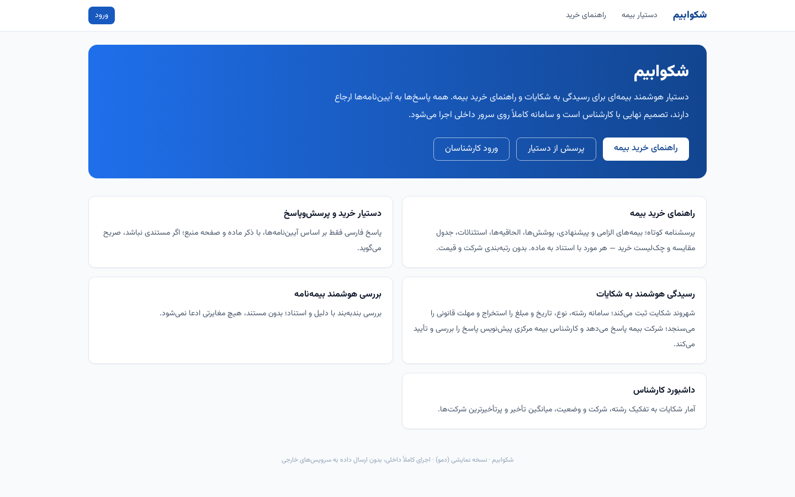

## نقش‌ها و آنچه هر کدام می‌بیند

هر نقش فقط همان بخشی را می‌بیند که به کارش مربوط است.

| نقش | آنچه می‌بیند و انجام می‌دهد |
|---|---|
| شهروند | شکایت خودش را ثبت می‌کند، شخص حقیقی یا حقوقی. پاسخ شرکت و پاسخ نهایی بیمه مرکزی را بعد از ثبت می‌بیند و اعلان می‌گیرد. راهنمای خرید، پرسش از آیین‌نامه و بررسی بیمه‌نامه هم برای او باز است. پیش‌نویس داخلی و پیشنهاد مسیر رسیدگی را نمی‌بیند. |
| کارشناس شرکت بیمه | فقط شکایت‌هایی را می‌بیند که بیمه مرکزی به شرکت خودش ارجاع داده است. پاسخ شرکت را در زبانه جدا می‌نویسد و داشبورد همان شرکت را دارد. داده شرکت‌های دیگر و بررسی بیمه‌نامه در اختیار او نیست. |
| کارشناس بیمه مرکزی | همه شکایت‌ها، پیشنهاد مسیر، ارجاع به شرکت، پیش‌نویس و پاسخ نهایی، داشبورد کل و گزارش رویدادها. |
| مدیر سامانه | کار کارشناس، به‌علاوه بارگذاری آیین‌نامه و مدیریت کاربران. |

## رسیدگی به شکایات

مسیر یک پرونده این است: شاکی به زبان خودش می‌نویسد، سامانه رشته و نوع را تشخیص می‌دهد و تاریخ و مبلغ را بیرون می‌کشد، خط زمانی و تأخیر را با مهلت همان رشته می‌سنجد، مواد مرتبط را با شماره ماده کنار پرونده می‌گذارد، و برای کارشناس پیشنهاد اقدام و پیش‌نویس آماده می‌کند. تصمیم نهایی با کارشناس است.

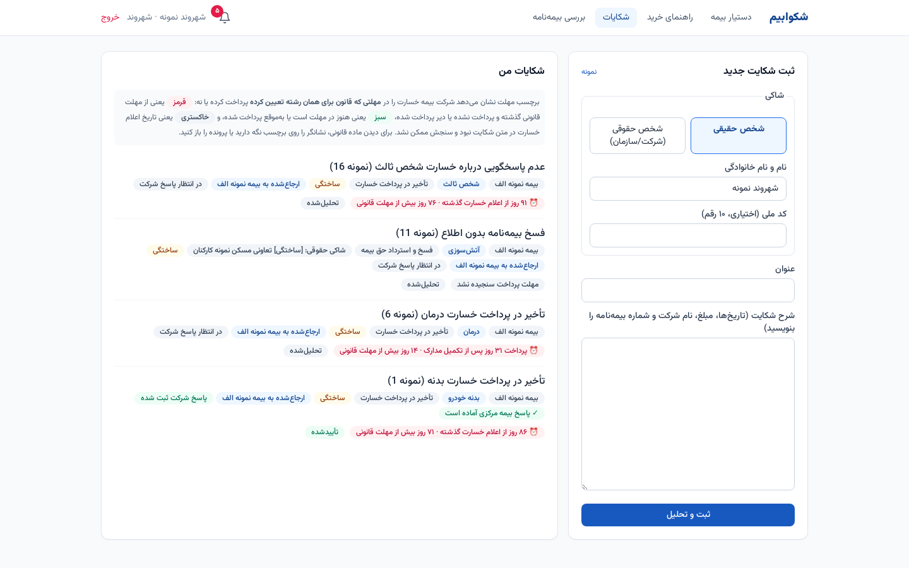

شاکی می‌تواند شخص حقیقی یا شخص حقوقی باشد. برای شخص حقوقی، نام سازمان، شناسه ملی و نام نماینده گرفته می‌شود.

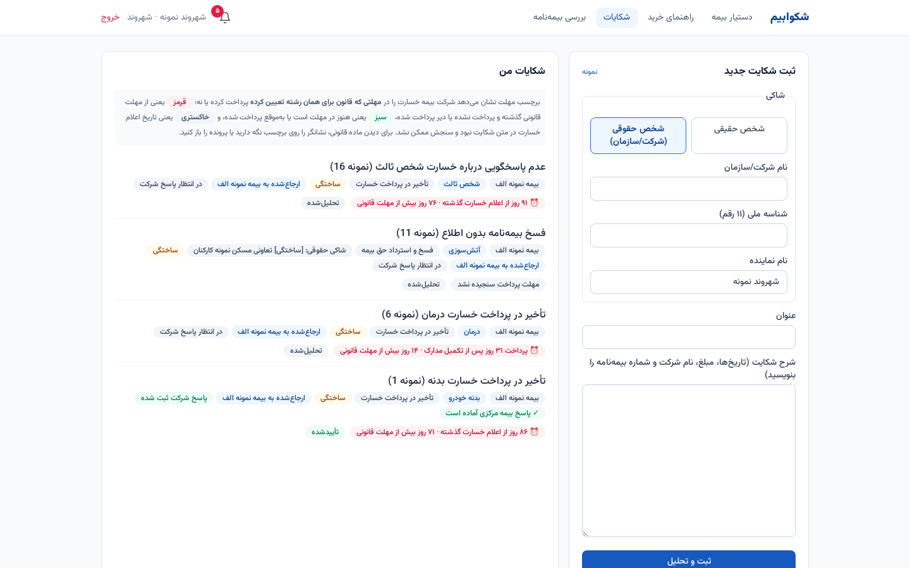

روی میز کارشناس، همان پرونده یک‌جا دیده می‌شود: متن شاکی، شرکت و رشته و نوع، مبلغ، مهلت قانونی با نقل ماده، خط زمانی، مقررات مرتبط، و پیشنهاد مسیر رسیدگی. پیشنهاد یکی از این سه است: ارجاع به شرکت بیمه، پاسخ مستقیم بیمه مرکزی، یا درخواست مدارک از شاکی. متن ارجاع از پیش نوشته شده و قابل ویرایش است. تا کارشناس دکمه را نزند، چیزی برای شاکی یا شرکت ارسال نمی‌شود.

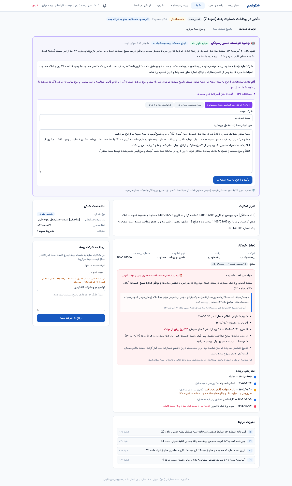

پاسخ شرکت بیمه و پاسخ بیمه مرکزی در دو زبانه جدا هستند. شاکی پاسخ شرکت را می‌بیند، اما پاسخ نهایی فقط پس از تصمیم کارشناس در زبانه بیمه مرکزی ظاهر می‌شود و برایش اعلان می‌آید.

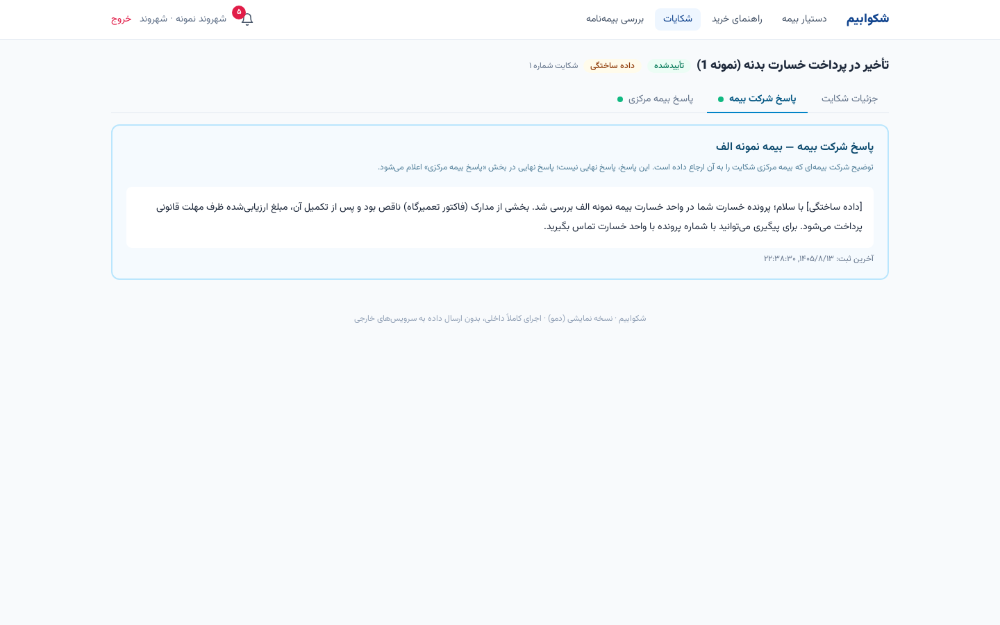

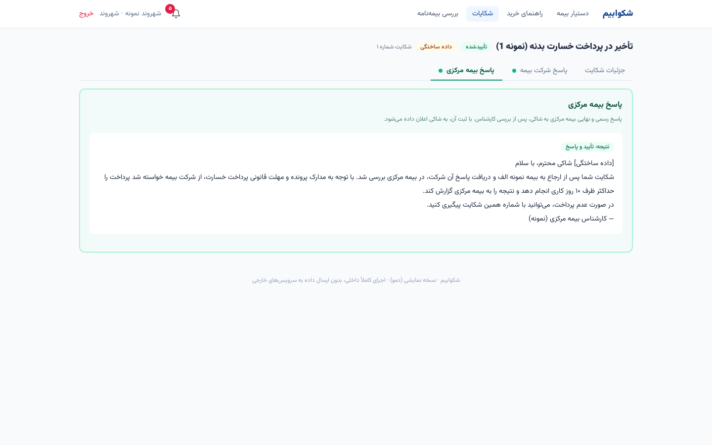

اگر پاسخ شرکت کوتاه یا ناکافی باشد، سامانه آن را با خواسته قانونی پرونده می‌سنجد و دو متن آماده می‌کند: پیش‌نویس پاسخ نهایی به شاکی، یا بازگشت پرونده به شرکت برای پاسخ کامل‌تر. باز هم ارسال با کلیک کارشناس است.

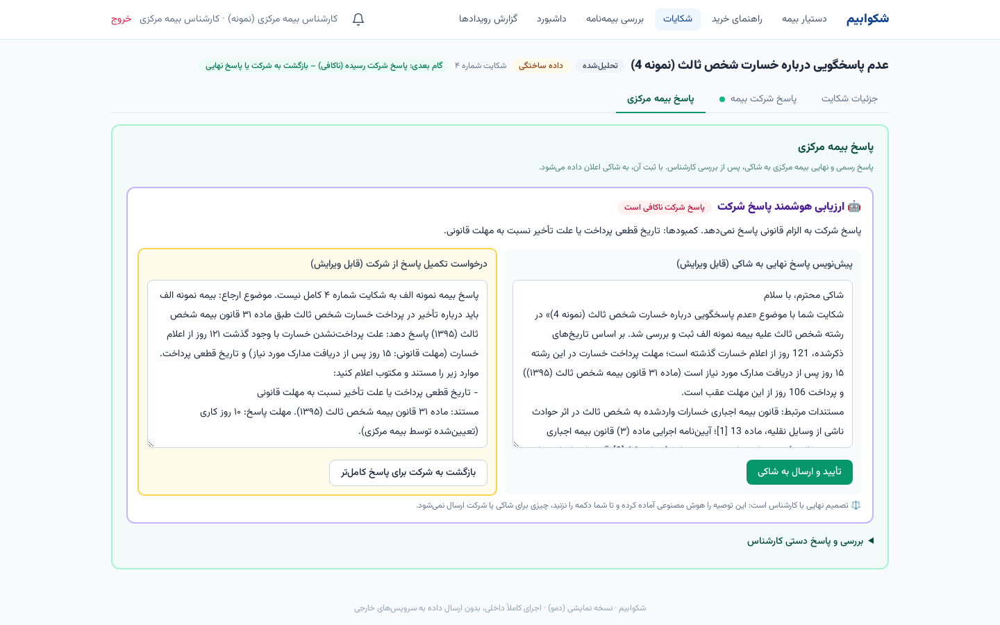

اعلان‌ها شاکی، شرکت و کارشناس را از ارجاع، پاسخ شرکت و پاسخ نهایی باخبر می‌کنند.

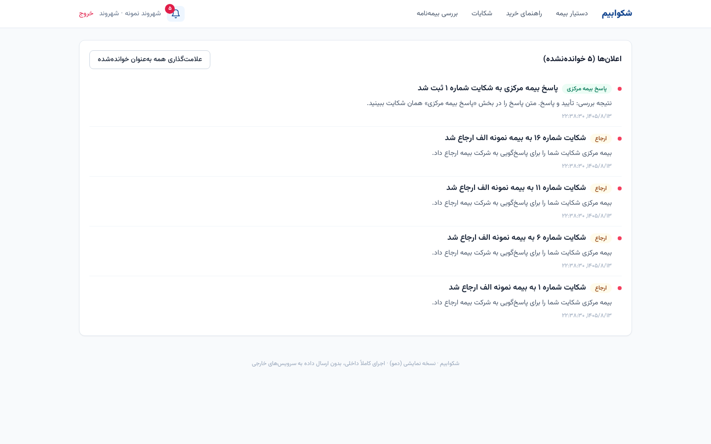

شرکت بیمه فقط صف ارجاع‌شده به خودش را می‌بیند.

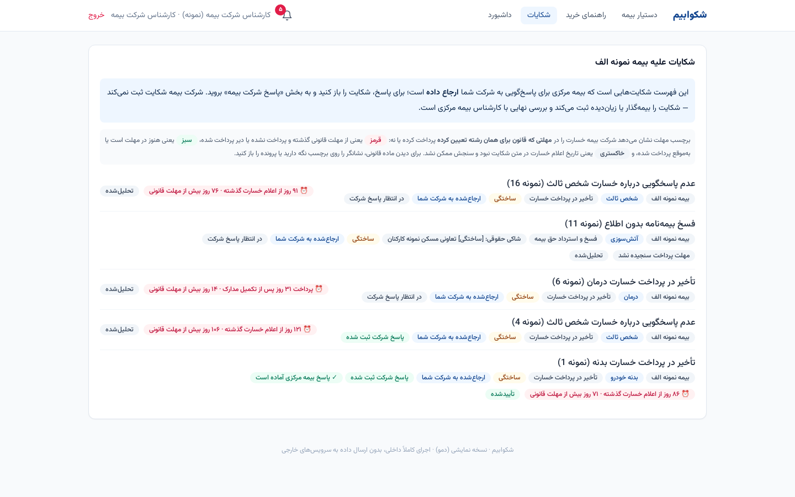

داشبورد، شکایت‌ها را به تفکیک شرکت و رشته نشان می‌دهد و شرکتی و رشته‌ای را که بیشترین عقب‌افتادگی از مهلت قانونی را دارند برجسته می‌کند. شرکت بیمه همین نما را فقط برای پرونده‌های خودش دارد، بدون داده شرکت‌های دیگر.

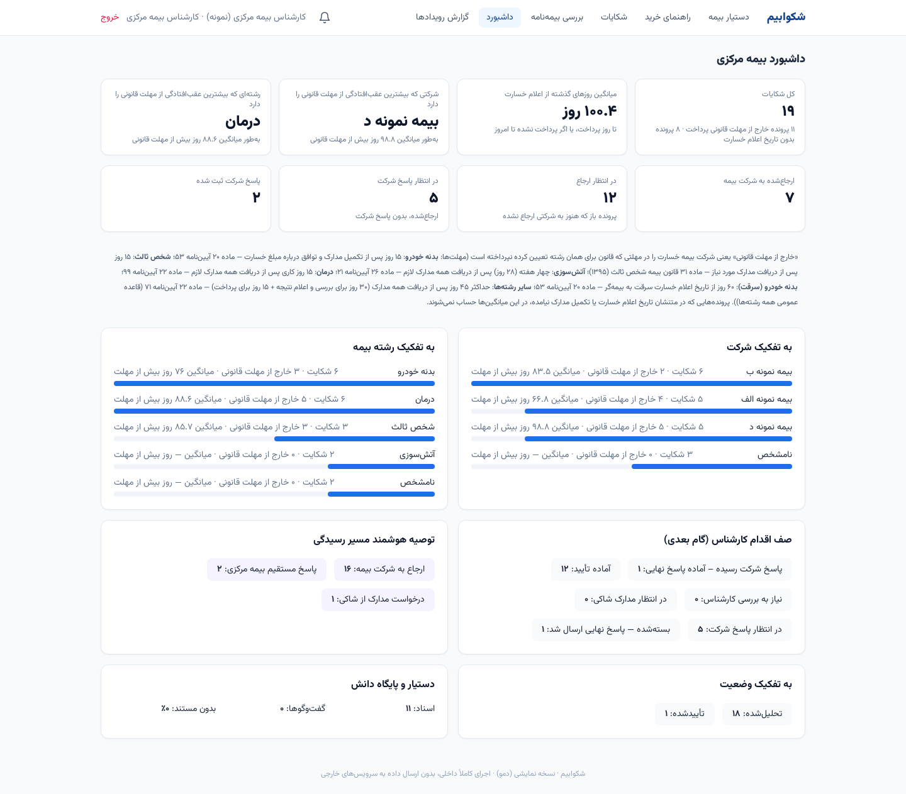

حرکت کوتاه همین مسیر، از صف کارشناس تا پیشنهاد رسیدگی، زبانه پاسخ شرکت، زبانه پاسخ بیمه مرکزی و داشبورد:

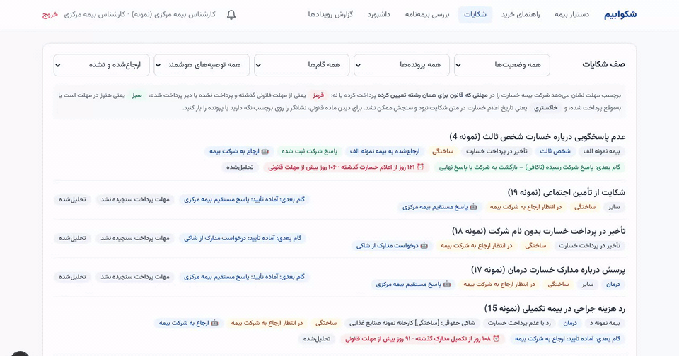

## دستیار خرید و پرسش‌وپاسخ

بند ۳ فراخوان از دستیار خرید سه چیز خواسته است: شناخت نیاز، معرفی بیمه مناسب همراه با حداقل الزام قانونی، و مقایسه پوشش‌ها و استثناها. شکوابیم این را به دو شکل دارد: پرسش به زبان خودِ کاربر، و یک پرسشنامه هدایت‌شده. هیچ‌کدام شرکت بیمه را رتبه‌بندی نمی‌کنند و قیمت اعلام نمی‌کنند. هر جمله‌ای که به مقرره تکیه دارد شماره منبع دارد.

پرسش درباره کارگاه، به پوشش آتش، صاعقه و انفجار محل کار می‌رسد و ماده آیین‌نامه آتش‌سوزی را نشان می‌دهد.

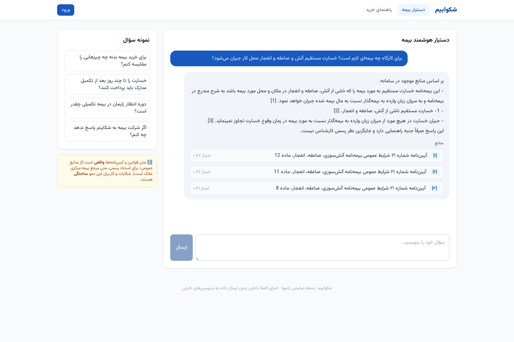

پرسش درباره خودرو، تکلیف دارنده وسیله نقلیه به تهیه بیمه شخص ثالث را از متن قانون می‌آورد.

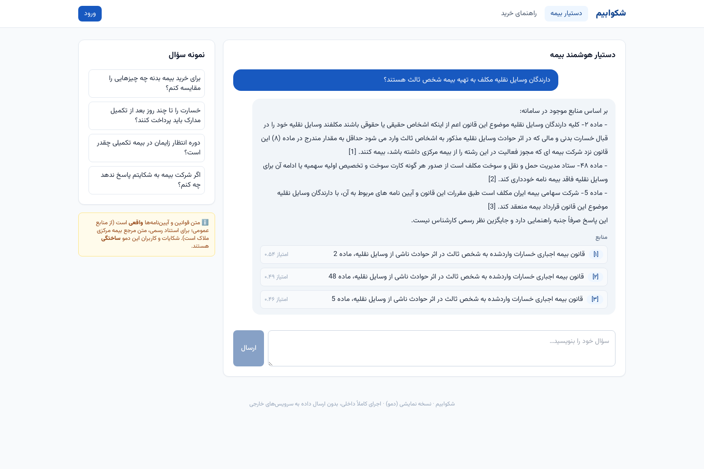

پرسش درباره پوشش و استثنا، سیل و زلزله را خارج از پوشش پایه بدنه می‌گذارد مگر آنکه در بیمه‌نامه یا الحاقیه توافق شده باشد.

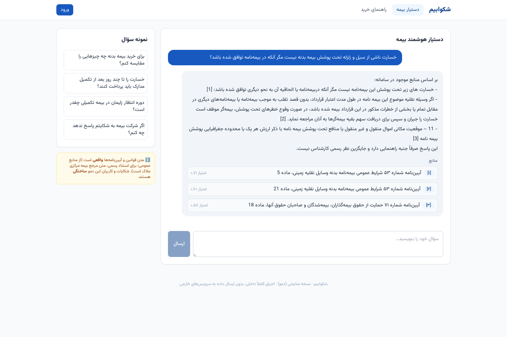

اگر پرسش در آیین‌نامه‌های سامانه نباشد، دستیار جوابی از خودش نمی‌سازد و می‌گوید مستندی پیدا نکرده است.

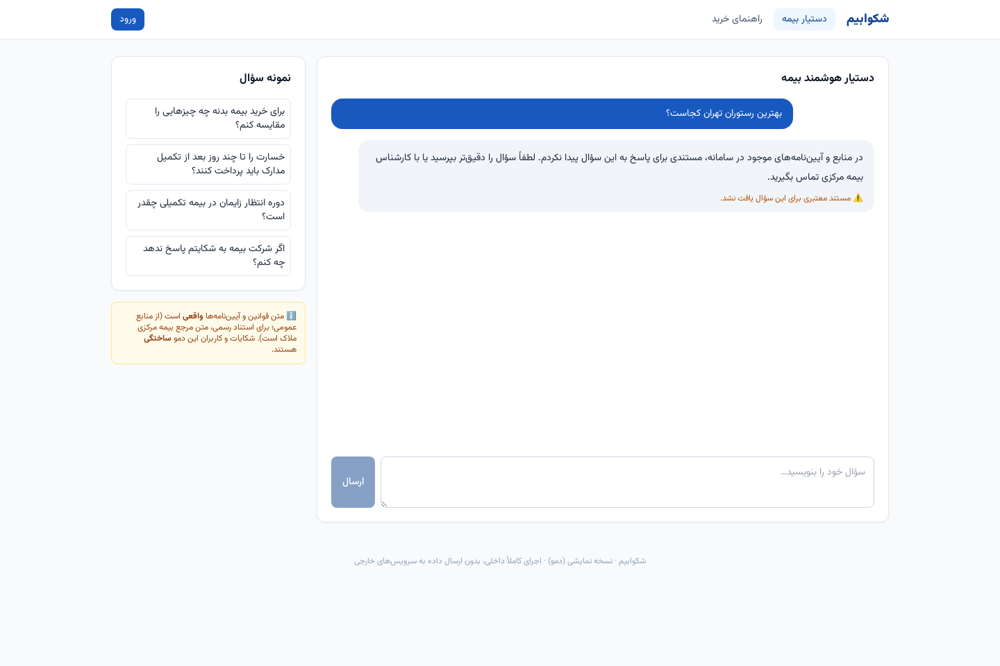

مسیر هدایت‌شده برای کسی است که نمی‌داند چه بپرسد. رشته را انتخاب می‌کند، به چند پرسش کوتاه جواب می‌دهد، و خروجی ثابت می‌گیرد: بیمه‌های الزامی، پوشش و استثنا، جدول مقایسه، و چک‌لیست پیش از خرید. پای هر ردیف یک ماده است. در نمونه شخص ثالث، بیمه شخص ثالث و حوادث راننده الزامی آمده‌اند و حداقل قانونی با پوشش مالی بالاتر مقایسه شده است.

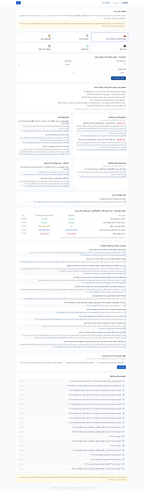

## بررسی هوشمند بیمه‌نامه

بند ۳ همچنین خواسته هر بند بیمه‌نامه با سه جزء دیده شود: مورد، دلیل، و مستند مقرراتی. کاربر متن بیمه‌نامه را در سامانه می‌گذارد. نمونه زیر یک بیمه‌نامه بدنه ساختگی است که برای همین نمایش چسبانده شده است.

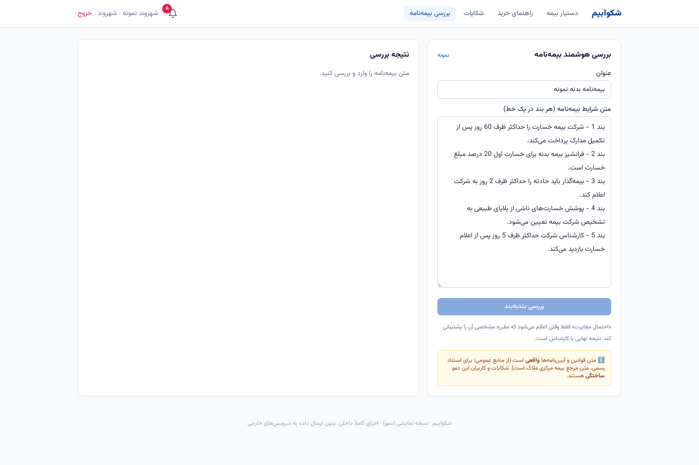

نتیجه بندبه‌بند است. برای هر بند، متن بند، دلیل، و در صورت وجود، نام آیین‌نامه و شماره ماده آمده است.

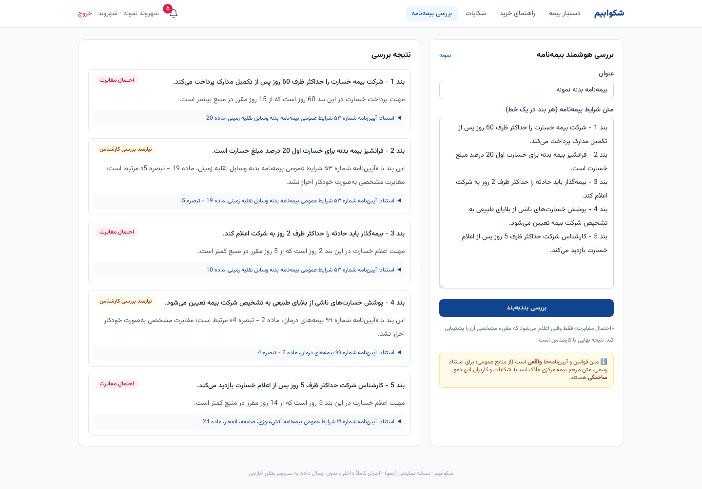

استناد باز می‌شود و متن همان ماده دیده می‌شود. در این بند، مهلت ۶۰ روزه پرداخت با مهلت ۱۵ روزه آیین‌نامه بدنه نمی‌خواند، پس برچسب «احتمال مغایرت» با نقل ماده آمده است.

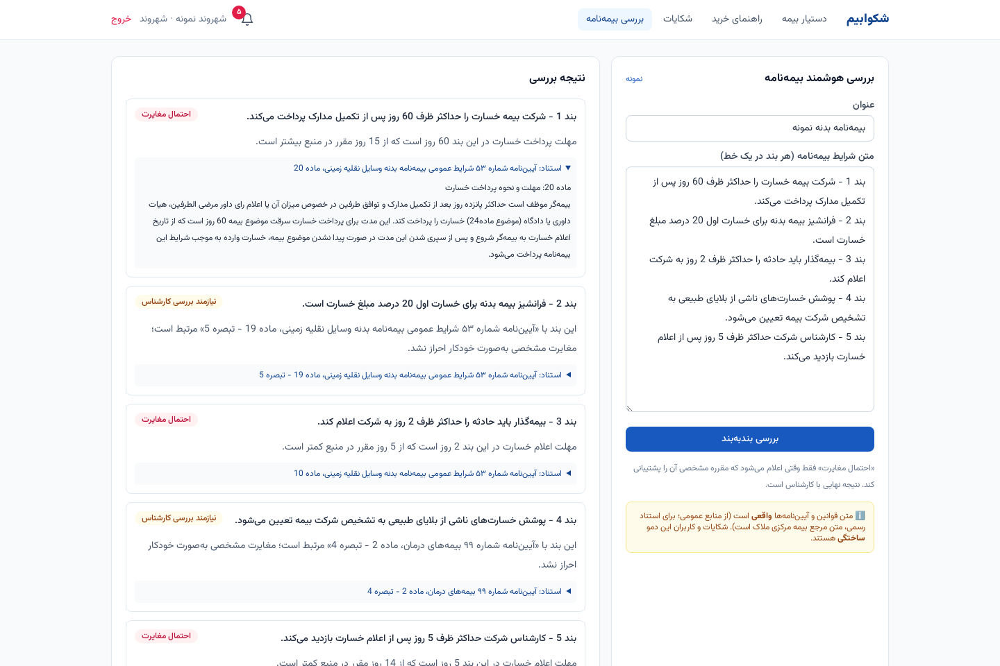

جایی که مقرره سقف یا ممنوعیت مشخصی نگفته، سامانه مغایرت اعلام نمی‌کند. فرانشیز ۲۰ درصد و واگذاری بلایای طبیعی به تشخیص شرکت، هر دو «نیازمند بررسی کارشناس» مانده‌اند، چون آیین‌نامه عدد فرانشیز را تعیین نکرده و پوشش بلایا را موکول به توافق در بیمه‌نامه کرده است.

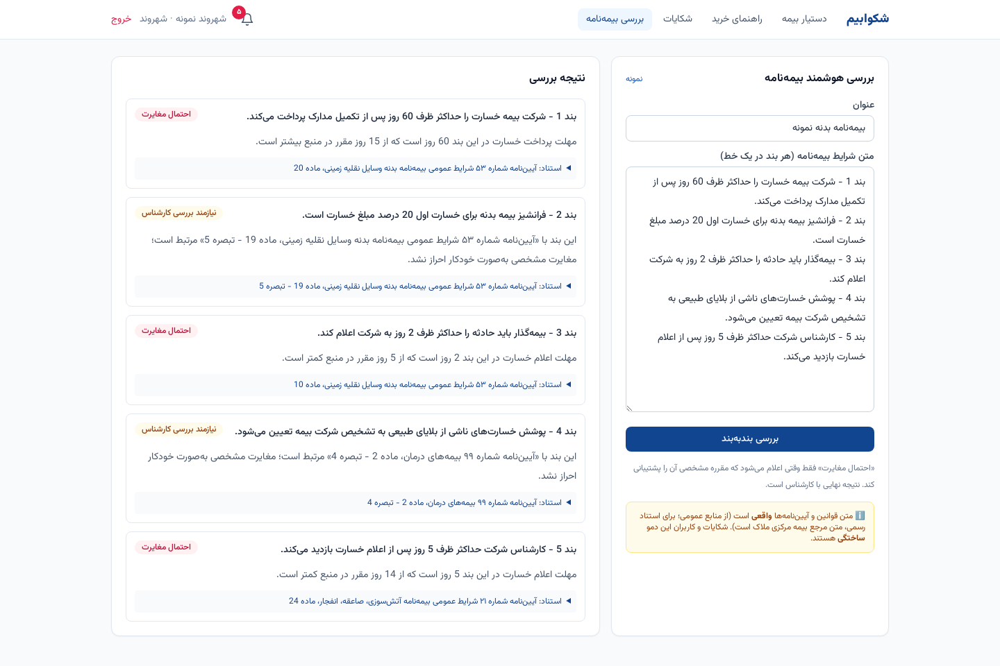

پرسش پوشیده‌شدن یا نپوشیده‌شدن هم به همین شکل جواب می‌گیرد. فرانشیز و استهلاک بدنه، طبق آیین‌نامه، به عهده بیمه‌گذار است و این جمله با شماره ماده آمده است.

## استناد، امتناع، گزارش رویداد و نظارت انسان

همان قاعده استناد و امتناع در بخش دستیار خرید دیده شد: پاسخ یا به ماده وصل است، یا صریحاً می‌گوید مستندی نیست.

ورود، مشاهده پرونده، جست‌وجو و تصمیم کارشناس در گزارش رویدادها ثبت می‌شود. در تصویر زیر شناسه کاربران پوشانده شده است.

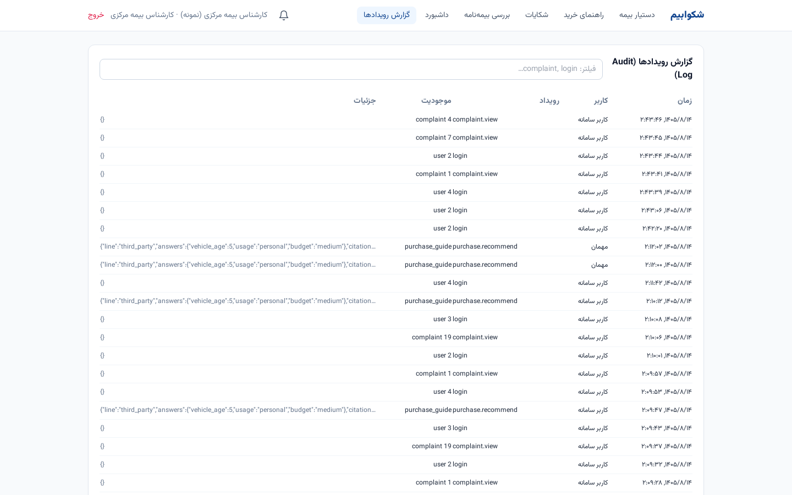

خروجی سامانه تا تأیید کارشناس پیش‌نویس است. این قاعده در خود رسیدگی اعمال شده است: شاکی و شرکت پیشنهاد مسیر و پیش‌نویس تأییدنشده را نمی‌بینند.

## آنچه در نمونه اولیه هست و آنچه مانده است

| خواسته | در نمونه اولیه | مانده |
|---|---|---|
| ثبت شکایت به زبان طبیعی | هست | دریافت پیوست اسکن‌شده |
| تشخیص رشته و نوع شکایت | هست | انطباق با طبقه‌بندی رسمی بیمه مرکزی |
| استخراج تاریخ و مبلغ، خط زمانی و تأخیر | هست | آستانه تأخیر جدا برای هر رشته، از متن خود مقرره |
| تطبیق با آیین‌نامه و ذکر ماده | هست | تکمیل کتابخانه و رتبه‌بندی مجدد نتایج |
| پیشنهاد اقدام و پیش‌نویس پاسخ | هست | اجرای مدل زبانی واقعی به‌جای قواعد این نسخه نمایشی |
| تصمیم نهایی با کارشناس | هست | |
| ارجاع به شرکت بیمه و جدابودن پاسخ شرکت از پاسخ بیمه مرکزی | هست | |
| اعلان به شاکی، شرکت و کارشناس | هست | |
| شاکی حقیقی و حقوقی | هست | |
| داشبورد پرتأخیرترین شرکت و رشته | هست | روند زمانی |
| راهنمای خرید با استناد، بدون قیمت و بدون رتبه‌بندی شرکت | هست | بازبینی پرسش‌ها با کارشناسان بیمه مرکزی |
| بررسی بیمه‌نامه با دلیل و استناد، بدون ادعای مغایرت بی‌منبع | هست | خواندن تصویر اسناد اسکن‌شده |
| امتناع وقتی منبعی نیست | هست | |
| گزارش رویدادها | هست | |
| یادگیری مستمر از اصلاح کارشناس | ثبت اصلاح هست؛ چرخه یادگیری نیست | چرخه بازخورد |
| اتصال به سامانه‌های بیمه مرکزی | نیست | طبق توافق بعدی |

## وضعیت فعلی

این نسخه نمایشی با **قواعد** و یک **مدل جایگزین** کار می‌کند، نه با مدل زبانی واقعی. پیشنهاد مسیر رسیدگی، استخراج تاریخ و مبلغ، و سنجش مهلت در همین حالت قاعده‌محورند. مدل زبانی واقعی، خواندن تصویر اسناد اسکن‌شده، یادگیری مستمر و اتصال به سامانه‌های بیمه مرکزی ساخته نشده‌اند و در برنامه کار بعدی‌اند. اعداد و شکایت‌های داخل تصاویر ساختگی‌اند و نباید مبنای قضاوت درباره یک پرونده واقعی قرار بگیرند.

---

## English

**shekvabim** is a Persian, right-to-left assistant for Central Insurance of Iran: complaint handling, a buying assistant, and policy review for call #1.

A citizen files a complaint in ordinary language. The prototype classifies the line and the complaint type, extracts dates and amounts, builds a timeline, flags delay against the rule for that line, and places the relevant regulation next to the case with an article citation. It then suggests a next step — refer to the insurer, reply directly, or ask for documents — and drafts the text. Nothing is sent until a Central Insurance expert confirms it. The insurer’s reply and the Central Insurance reply sit on separate tabs. Citizens, insurer staff, experts and administrators each see only their own work. The buying assistant answers ordinary questions — a workshop, compulsory motor cover, an exclusion — with article citations, and refuses when it has no source. Its guided path asks a short questionnaire and returns mandatory cover, a comparison and a checklist. Policy review takes a pasted policy and judges each clause with a reason and, where one exists, a citation. It will not call a clause a violation unless a regulation supports that.

The pictures in this file are from that running prototype. Complaints and company names in them are synthetic. The demo uses rules and a stand-in model. A real language model, OCR of scanned documents, continuous learning, and integration with Central Insurance systems are planned, not built. Source code is available to evaluators on request. A captioned walkthrough is in [`docs/index.html`](docs/index.html).
